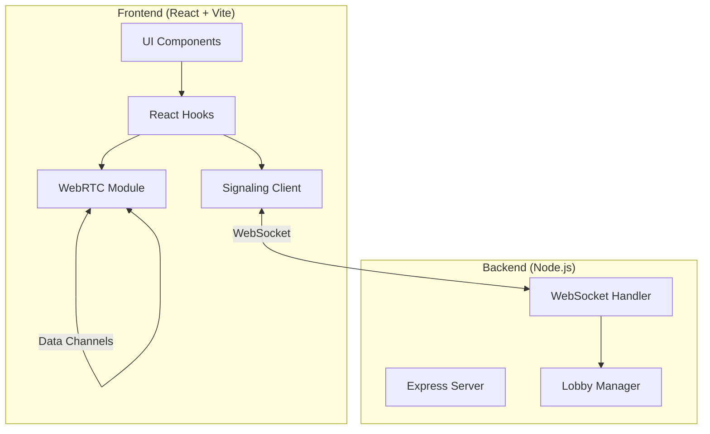

# Design Document

## Overview

GhostNet is a peer-to-peer chat application with a Halloween theme that enables real-time messaging between users on a local network. The system consists of two main components: a React/TypeScript frontend that handles UI rendering and WebRTC peer connections, and a Node.js/TypeScript backend signaling server that facilitates WebRTC connection establishment.

The architecture prioritizes simplicity and demonstrability for a hackathon context while maintaining clean code organization and type safety throughout.

## Architecture



### System Flow

1. User enters ghost name on welcome screen
2. Frontend establishes WebSocket connection to signaling server
3. Signaling server adds user to lobby and broadcasts presence
4. Frontend initiates WebRTC peer connections with existing ghosts
5. Once data channels are open, messages flow directly peer-to-peer
6. Signaling server only handles connection establishment, not message relay

### Topology

The system uses a mesh topology where each ghost maintains direct WebRTC data channel connections to all other ghosts. This is suitable for small groups (up to 8 ghosts) and eliminates server-side message relay.

## Components and Interfaces

### Frontend Components

#### WelcomeScreen
- Displays ghost name input with validation
- "Enter the Haunted Lobby" button
- Validates name format (3-20 chars, alphanumeric/hyphen/underscore)

#### Header
- App title "GhostNet" with spooky styling
- Current user's ghost name display
- Settings toggles for sound and shake effects

#### Sidebar
- List of connected ghosts
- Visual distinction for current user
- Real-time updates on join/leave

#### ChatArea
- Message history display
- Ghost messages with fade-in/fade-out animations
- Persistent messages that remain visible
- Shake animation container

#### MessageInput
- Text input field
- Action buttons: Send Ghost Message, Send Persistent Message, Shake Screen, Ghost Whisper

#### Toast/Notification
- Error notifications for connection failures
- Warning notifications for peer connection issues

### Frontend Modules

#### signaling.ts
```typescript
interface SignalingClient {
  connect(serverUrl: string): Promise<void>;
  disconnect(): void;
  sendJoin(ghostName: string): void;
  sendOffer(to: string, offer: RTCSessionDescriptionInit): void;
  sendAnswer(to: string, answer: RTCSessionDescriptionInit): void;
  sendIceCandidate(to: string, candidate: RTCIceCandidateInit): void;
  onGhostJoined(callback: (ghostName: string) => void): void;
  onGhostLeft(callback: (ghostName: string) => void): void;
  onGhostList(callback: (ghosts: string[]) => void): void;
  onOffer(callback: (from: string, offer: RTCSessionDescriptionInit) => void): void;
  onAnswer(callback: (from: string, answer: RTCSessionDescriptionInit) => void): void;
  onIceCandidate(callback: (from: string, candidate: RTCIceCandidateInit) => void): void;
}
```

#### webrtc.ts
```typescript
interface PeerManager {
  createPeerConnection(ghostName: string): RTCPeerConnection;
  createOffer(ghostName: string): Promise<RTCSessionDescriptionInit>;
  handleOffer(ghostName: string, offer: RTCSessionDescriptionInit): Promise<RTCSessionDescriptionInit>;
  handleAnswer(ghostName: string, answer: RTCSessionDescriptionInit): Promise<void>;
  addIceCandidate(ghostName: string, candidate: RTCIceCandidateInit): Promise<void>;
  sendMessage(message: WebRTCMessage): void;
  broadcast(message: WebRTCMessage): void;
  onMessage(callback: (from: string, message: WebRTCMessage) => void): void;
  onPeerConnected(callback: (ghostName: string) => void): void;
  onPeerDisconnected(callback: (ghostName: string) => void): void;
  closePeer(ghostName: string): void;
  closeAll(): void;
}
```

#### useGhostNet.ts (Custom Hook)
```typescript
interface UseGhostNetReturn {
  // State
  ghostName: string | null;
  connectedGhosts: string[];
  messages: Message[];
  connectionState: 'disconnected' | 'connecting' | 'connected' | 'error';
  error: string | null;
  
  // Settings
  soundEnabled: boolean;
  shakeEnabled: boolean;
  setSoundEnabled: (enabled: boolean) => void;
  setShakeEnabled: (enabled: boolean) => void;
  
  // Actions
  joinLobby: (name: string) => Promise<void>;
  sendGhostMessage: (text: string) => void;
  sendPersistentMessage: (text: string) => void;
  triggerShake: () => void;
  triggerWhisper: () => void;
  
  // Effects
  isShaking: boolean;
}
```

### Backend Components

#### server.ts
- Express server setup
- WebSocket server initialization
- CORS configuration for local development

#### signaling.ts
```typescript
interface SignalingHandler {
  handleConnection(ws: WebSocket): void;
  handleMessage(ws: WebSocket, message: SignalingMessage): void;
  handleDisconnect(ws: WebSocket): void;
}

interface LobbyManager {
  addGhost(ghostName: string, ws: WebSocket): void;
  removeGhost(ghostName: string): void;
  getGhosts(): string[];
  broadcast(message: SignalingMessage, exclude?: string): void;
  sendTo(ghostName: string, message: SignalingMessage): void;
}
```

## Data Models

### Signaling Messages (Backend ↔ Frontend)

```typescript
type SignalingMessageType = 
  | 'join'
  | 'leave'
  | 'ghost_list'
  | 'ghost_joined'
  | 'ghost_left'
  | 'offer'
  | 'answer'
  | 'ice_candidate'
  | 'error';

interface SignalingMessage {
  type: SignalingMessageType;
  from?: string;
  to?: string;
  payload?: unknown;
}

interface JoinMessage {
  type: 'join';
  payload: { ghostName: string };
}

interface GhostListMessage {
  type: 'ghost_list';
  payload: { ghosts: string[] };
}

interface OfferMessage {
  type: 'offer';
  from: string;
  to: string;
  payload: RTCSessionDescriptionInit;
}

interface AnswerMessage {
  type: 'answer';
  from: string;
  to: string;
  payload: RTCSessionDescriptionInit;
}

interface IceCandidateMessage {
  type: 'ice_candidate';
  from: string;
  to: string;
  payload: RTCIceCandidateInit;
}
```

### WebRTC Messages (Peer ↔ Peer)

```typescript
type WebRTCMessageType = 
  | 'ghost_message'
  | 'persistent_message'
  | 'shake'
  | 'whisper';

interface BaseWebRTCMessage {
  type: WebRTCMessageType;
  sender: string;
  timestamp: number;
}

interface GhostMessage extends BaseWebRTCMessage {
  type: 'ghost_message';
  content: string;
}

interface PersistentMessage extends BaseWebRTCMessage {
  type: 'persistent_message';
  content: string;
}

interface ShakeMessage extends BaseWebRTCMessage {
  type: 'shake';
}

interface WhisperMessage extends BaseWebRTCMessage {
  type: 'whisper';
}

type WebRTCMessage = GhostMessage | PersistentMessage | ShakeMessage | WhisperMessage;
```

### UI State Models

```typescript
interface Message {
  id: string;
  type: 'ghost' | 'persistent';
  sender: string;
  content: string;
  timestamp: number;
  isOwn: boolean;
}

interface Ghost {
  name: string;
  isConnected: boolean;
  isCurrentUser: boolean;
}

interface AppSettings {
  soundEnabled: boolean;
  shakeEnabled: boolean;
}

type ConnectionState = 'disconnected' | 'connecting' | 'connected' | 'error';
```


## Correctness Properties

*A property is a characteristic or behavior that should hold true across all valid executions of a system-essentially, a formal statement about what the system should do. Properties serve as the bridge between human-readable specifications and machine-verifiable correctness guarantees.*

### Property 1: Ghost Name Validation

*For any* string input, the ghost name validation function SHALL accept the string if and only if it is between 3 and 20 characters (inclusive) and contains only alphanumeric characters, hyphens, or underscores.

**Validates: Requirements 1.2**

### Property 2: Server Join Handling

*For any* lobby state with N existing ghosts and a new ghost joining, the signaling server SHALL broadcast the new ghost's presence to all N existing ghosts AND send the list of N existing ghosts to the newly joined ghost.

**Validates: Requirements 2.3, 2.4**

### Property 3: Sidebar Ghost List Rendering

*For any* list of connected ghosts, the sidebar component SHALL render exactly one entry for each ghost in the list, with the current user's entry visually distinguished.

**Validates: Requirements 4.1**

### Property 4: Message Broadcast to All Peers

*For any* message (ghost message, persistent message, shake, or whisper) sent by a ghost, the message SHALL be transmitted to all connected peers via their respective WebRTC data channels.

**Validates: Requirements 5.1, 6.1, 7.1, 8.1**

### Property 5: Message Display Format

*For any* chat message (ghost or persistent) displayed in the UI, the rendered output SHALL contain the sender's ghost name, the message text content, and a formatted timestamp.

**Validates: Requirements 5.2, 6.2**

### Property 6: Persistent Message Retention

*For any* persistent message added to the message list, the message SHALL remain in the list indefinitely (not be removed by any automatic cleanup process) during the session.

**Validates: Requirements 6.3**

### Property 7: Ghost List Disconnect Update

*For any* ghost that disconnects (peer connection closes), the ghost list state SHALL be updated to remove that ghost within the update cycle.

**Validates: Requirements 10.2**

### Property 8: Message Serialization Round-Trip

*For any* valid WebRTCMessage object, serializing to JSON and then deserializing back SHALL produce an equivalent object with all fields (type, sender, content if applicable, timestamp) preserved.

**Validates: Requirements 11.1, 11.2, 11.3, 12.1**

### Property 9: Message Type Routing

*For any* received WebRTC message with a known type, the message handler SHALL route the message to the correct handler function based on the type field value.

**Validates: Requirements 12.2**

### Property 10: Sound Mute Setting Respected

*For any* whisper control signal received while sound is muted, the system SHALL NOT trigger audio playback but SHALL still process the message event.

**Validates: Requirements 13.2**

### Property 11: Shake Disable Setting Respected

*For any* shake control signal received while shake is disabled, the system SHALL NOT trigger the shake animation but SHALL still process the message event.

**Validates: Requirements 13.3**

### Property 12: Signaling Server Message Scope

*For any* message received by the signaling server, the server SHALL only process messages of types: join, leave, offer, answer, and ice_candidate. All other message types SHALL be ignored.

**Validates: Requirements 15.3**

## Error Handling

### Frontend Error Handling

| Error Scenario | Handling Strategy |
|----------------|-------------------|
| WebSocket connection failure | Display error toast, disable chat functionality, show retry option |
| WebRTC not supported | Display error banner on app load, prevent lobby entry |
| Peer connection failure | Display warning toast, remove ghost from connected list, continue with other peers |
| Invalid ghost name | Display inline validation error, prevent form submission |
| Message send failure | Log error, optionally show brief error indicator |
| Unknown message type | Log warning, ignore message silently |

### Backend Error Handling

| Error Scenario | Handling Strategy |
|----------------|-------------------|
| Invalid JSON message | Log error, ignore message |
| Unknown message type | Log warning, ignore message |
| Ghost name collision | Send error message to client |
| WebSocket error | Clean up ghost from lobby, notify other ghosts |

## Testing Strategy

### Property-Based Testing Library

The project will use **fast-check** for property-based testing in TypeScript. Fast-check provides excellent TypeScript support and integrates well with Jest/Vitest.

### Property-Based Tests

Each correctness property will be implemented as a property-based test with a minimum of 100 iterations:

1. **Ghost Name Validation Property Test**
   - Generate random strings of varying lengths and character sets
   - Verify validation function correctly accepts/rejects based on rules
   - Tag: `**Feature: ghostnet, Property 1: Ghost Name Validation**`

2. **Message Serialization Round-Trip Property Test**
   - Generate random valid WebRTCMessage objects
   - Serialize to JSON, deserialize back
   - Verify equality of original and round-tripped object
   - Tag: `**Feature: ghostnet, Property 8: Message Serialization Round-Trip**`

3. **Message Type Routing Property Test**
   - Generate random messages of each known type
   - Verify correct handler is invoked for each type
   - Tag: `**Feature: ghostnet, Property 9: Message Type Routing**`

4. **Signaling Server Message Scope Property Test**
   - Generate random signaling messages of valid and invalid types
   - Verify server only processes valid signaling types
   - Tag: `**Feature: ghostnet, Property 12: Signaling Server Message Scope**`

### Unit Tests

Unit tests will cover:

- Ghost name validation edge cases (empty, too short, too long, special characters)
- Message creation and formatting utilities
- Timestamp formatting
- Settings toggle state management
- Ghost list add/remove operations

### Integration Tests

Integration tests will verify:

- WebSocket connection establishment
- Signaling message exchange flow
- End-to-end message sending between two simulated peers

### Test File Organization

```
frontend/
  src/
    lib/
      __tests__/
        validation.test.ts
        validation.property.test.ts
        messages.test.ts
        messages.property.test.ts
    hooks/
      __tests__/
        useGhostNet.test.ts

backend/
  src/
    __tests__/
      signaling.test.ts
      signaling.property.test.ts
```
